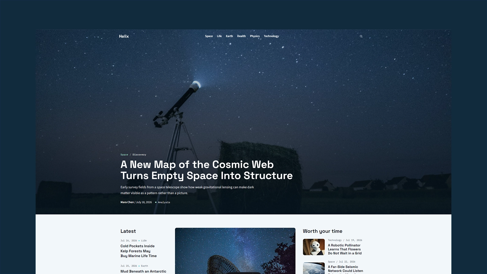

# Helix - Astro Science Publication Theme

[](https://helix.xocoweb.workers.dev/)

[](https://astro.build/)
[](https://tailwindcss.com/)
[](https://www.typescriptlang.org/)
[](./LICENSE)

**Live preview:** https://helix.xocoweb.workers.dev/

Helix is an Astro theme for science publications covering space, life, Earth systems, health, physics, technology, and field reporting. Its evidence-forward editorial design, research-status labels, citation fields, and image-led homepage help readers understand discoveries without hiding uncertainty. Mostly static output keeps pages fast, articles crawlable, and the publication straightforward to customize.

## Features

- Science front page with a full-bleed lead story, three-column briefing, draggable category image slider, Field Notes feature, paired Earth and Space sections, living-world coverage, Physics and Technology blocks, and compact latest-story list
- Sticky masthead with accessible desktop navigation, mobile navigation drawer, search trigger, and transparent homepage/category variants
- Statically generated category, tag, author index/profile, article, archive, search, RSS, robots, sitemap, changelog, standards, privacy, contact, about, and 404 pages
- Category and All Stories pagination with crawlable previous/next links
- Header search that lazy-loads a generated static JSON index, plus a standalone search page with query-string support
- Markdown content powered by Astro content collections
- Frontmatter validation for titles, descriptions, categories, dates, authors, article types, research status, images, key findings, methodology notes, citations, figures, featured states, trending flags, and drafts
- Automatic responsive post-image optimization with Astro-generated WebP sources, JPG fallbacks, `srcset`, `sizes`, and LCP fetch-priority hints
- Central site, category, newsletter, contact, social, and SEO defaults
- Canonical URLs, sitemap generation, RSS, Open Graph, Twitter/X cards, and JSON-LD
- Accessible skip link, landmarks, labels, keyboard-friendly menus/search, print controls, and visible focus states
- One focused light visual identity with semantic design tokens
- Self-hosted font files with no external font request
- Tailwind CSS 4 tokens, scoped Astro styles, and minimal JavaScript limited to user-facing interactions
- Wide article pages with reading progress, lead image credits, key findings, table of contents, research-status context, source lists, share links, print action, author bio, previous/next links, and related-story recommendations
- Provider-neutral newsletter and contact forms with empty actions by default
- Local Bootstrap social icons with their license notice

## Tech Stack

- Astro 7
- Tailwind CSS 4 via the Vite plugin
- Vite 8
- TypeScript
- Astro content collections
- `@astrojs/sitemap`
- `rehype-slug`
- Sharp for image processing

## Requirements

- Node.js `22.12.0` or newer
- npm

## Getting Started

```bash
npm install
npm run dev
```

Build for production:

```bash
npm run build
```

Preview the production build locally:

```bash
npm run preview
```

Run the complete release check:

```bash
npm run release:check
```

## Deployment

Helix builds to static files in `dist/` and can be deployed to any static host. Use `npm run build` as the build command and `dist` as the publish directory.

The included `wrangler.jsonc` is ready for a Cloudflare Workers static-assets deployment. Update the project name if needed, build the theme, and deploy with your normal Wrangler workflow.

## Customization

See [CUSTOMIZATION.md](./CUSTOMIZATION.md) for site settings, categories, posts, homepage sections, search, newsletter, contact forms, images, icons, pages, fonts, and theme tokens.

## Project Notes

- Contributor and quality standards live in [AGENTS.md](./AGENTS.md).
- The included stories, contact details, form actions, social destinations, legal copy, and default domain are demonstration defaults. Replace them before publishing a real publication.

## Content

Posts live in [src/content/posts](./src/content/posts). Each post is a folder with an `index.md` file. Frontmatter is validated by the schema in [src/content.config.ts](./src/content.config.ts).

Post images live beside their respective `index.md` files and are referenced with relative paths such as `./story-image.jpg`. Theme-controlled post images are optimized at build time into responsive WebP variants with JPG fallbacks, so visitors download an appropriate format and size for their device. Author pages are generated from each post's `author.name` field, with URLs such as `/author/leah-morgan/`.

## Support

See [SUPPORT.md](./SUPPORT.md) for what is included with a license.

## License

Commercial license. See [LICENSE](./LICENSE) for complete terms.
